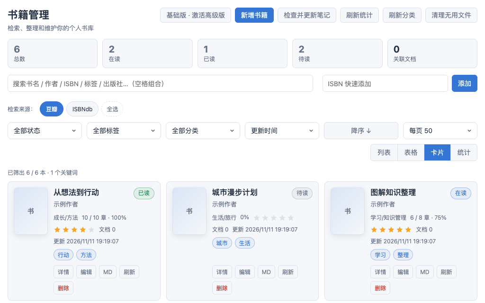
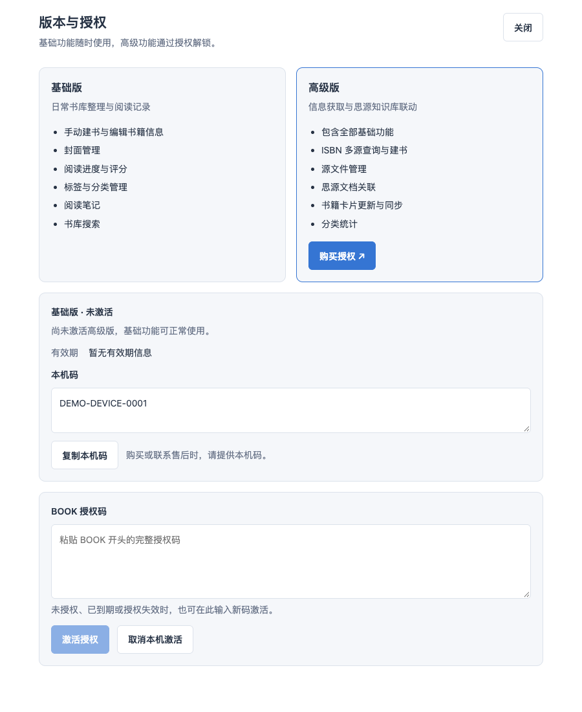

# Book Manager

Keep your library, reading progress, and notes in one connected workflow. Maintain books manually, or use Pro for ISBN lookup, source-file management, and SiYuan document integration.

[简体中文](README_zh_CN.md) · [Official repository](https://github.com/zhangzhishi1/siyuan-plugin-book-manager) · [Downloads](https://github.com/zhangzhishi1/siyuan-plugin-book-manager/releases) · [Report an issue](https://github.com/zhangzhishi1/siyuan-plugin-book-manager/issues) · [Purchase Pro](https://e.tb.cn/h.j9xZFoT3Oz3FKjg?tk=wTj86dm4H5t)

## Version 0.1.4 Notes

The current implementation uses the official plugin ID `siyuan-plugin-book-manager` and version 0.1.4, with Basic / Pro runtime restrictions and the licensing dialog implemented. It continues using the official repository above, not a separate personal-build release channel.

Version 0.1.4 includes Basic / Pro feature gates, a version-and-license panel, explicit online activation, a single startup license check, and offline fallback for previously activated, locally valid licenses. These describe implemented behavior, not a claim that a real license has been activated or that 0.1.4 is already available for download. Use the versions actually listed in Releases.

## Preview

This 1024 × 640 preview is rendered from the actual 0.1.4 library component with demonstration books, not an older screenshot or a recreated mockup. Provider labels reflect the component UI, not a guarantee of provider availability or successful lookup.

The 900 × 1100 license-panel capture uses the actual component in its unactivated Basic state, with the demonstration machine code `DEMO-DEVICE-0001` and an empty license-code field. It shows edition differences and activation controls, not a successful real activation or a verified server response. Both captures use demonstration data outside SiYuan; host-specific workflows still require validation in SiYuan.

The distribution repository contains only the contents of the production output at its root. The image URLs above therefore target `main/preview.png` and `main/assets/license-panel.png`, not source-workspace paths; they will match after the corresponding assets are published. Their inclusion here does not mean publication has occurred.

## Basic and Pro Editions

| Feature | Basic | Pro |
| --- | --- | --- |
| Manually add, edit, and delete books and maintain metadata | Included | Included |
| Upload or paste covers and download remote covers locally | Included | Included |
| To-read / reading / finished / paused status, progress, chapters, and ratings | Included | Included |
| Manual categories, tags, and personal notes | Included | Included |
| List / table / grid views, search, filters, and sorting | Included | Included |
| Multi-provider ISBN lookup and automatic metadata completion | — | Included |
| PDF, EPUB, MOBI, AZW3, TXT, other source files, and external links | — | Included |
| Link SiYuan documents; generate, check, and update book cards | — | Included |
| Document-tree category sync, reading and linked-document statistics, category and tag overviews | — | Included |

- Search titles, authors, ISBNs, tags, publishers, and personal notes using multiple keywords. Filter by status, category, and tags; sort by update time, title, author, progress, rating, and other available fields.
- Compare ISBN candidates from providers such as Douban and ISBN Search to complete titles, authors, publishers, publication dates, covers, and tags. Results depend on provider coverage and network availability; not every ISBN will return a match.
- Each book links to one SiYuan document; relinking replaces the previous association. Linked categories follow the document's parent path. Card updates replace only book-identified, plugin-managed blocks and preserve other handwritten content.
- Pro includes all Basic features. Expiration, revocation, or deactivation returns the plugin to Basic without deleting books, personal notes, source files, or associations. Existing Pro data remains viewable; Pro additions, changes, and synchronization pause until a valid license is restored.

## Installation and Upgrades

Requires **SiYuan 3.7.0+ on Windows, macOS, or Linux desktop**. Mobile support is not promised.

1. Search for Book Manager in SiYuan's Settings → Bazaar → Plugins, verify the official repository above, then install and enable it.
2. For manual installation, select an actually published version from the [official Releases](https://github.com/zhangzhishi1/siyuan-plugin-book-manager/releases), download `package.zip`, and extract it into `data/plugins/siyuan-plugin-book-manager/` in your workspace. A GitHub source archive is not an installation package.
3. Before upgrading, back up the workspace, including `data/storage/petal/`, relevant `data/assets/`, and note documents. Update through the Bazaar, or disable the plugin and replace its program files with the official package without deleting business-data directories.
4. Disable and re-enable the plugin, or restart SiYuan, to load new code and run the startup license check. Verify book counts, covers, source files, and document links afterward.

The independent personal build and the official plugin have different identities and private-data directories. **Do not assume that the official plugin automatically imports personal-build data.** Back up and verify migration first; disable the old build only after confirming that books and resources are intact. Do not directly delete or overwrite the old directories.

## Getting Started

1. Open the library using the top-bar book icon. Add a book manually and enter metadata, a cover, status, progress, rating, and personal notes.
2. Organize the library with search, category and tag filters, and sorting. These operations belong to Basic.
3. After activating Pro, enter an ISBN and choose a provider candidate to complete metadata, then attach local source files or external links.
4. Find and link a SiYuan document. Select Update Note to write or refresh its book card; use Check and Update Notes, Refresh Categories, and Refresh Statistics to maintain integrations.

## Purchasing and Licensing Pro

[Purchase Pro](https://e.tb.cn/h.j9xZFoT3Oz3FKjg?tk=wTj86dm4H5t). License duration, device rules, and deliverables are subject to the purchase page and the issued license. No unconfirmed prices are listed here.

Plugin settings include an Activate button that opens a dialog showing the machine code and an input for a `BOOK` license code. Supply the machine code as instructed on the purchase page, paste the issued license code, and activate it explicitly. Every explicit activation requires a successful online response; local signature verification alone does not activate Pro.

The implemented and regression-tested lifecycle is:

- **Local validation:** a pure licensing module uses WebCrypto Ed25519 with a public key to verify signatures and check application, product, version, device binding, and validity period. Unsupported verification environments reject activation rather than bypassing verification. Existing official `BOOK` codes and their device-binding contract remain compatible; compatibility does not waive validity checks.
- **Startup check:** once per plugin load, call `/check` for a locally valid license and cache the result for that lifecycle. Pro feature gates read the cached state without repeated requests or signature verification.
- **Explicit activation:** submitting a code performs local validation and calls `/activate`. Only `ok: true` with `status: "active"`, followed by successful local persistence, enables the submitted code and immediately updates open interfaces. Network failure does not activate it.
- **Offline fallback:** an already activated license that remains locally valid retains Pro access during startup network failure. Persisted licenses from older official versions without an activation marker are treated as legacy activations; an explicit `activated: false` is not eligible. This does not permit offline first activation or invalid/expired licenses. An explicit server rejection is not a network outage.
- **Invalidation timing:** remote revocation and expiration occurring during a session are re-evaluated and applied on the next plugin load. Re-enabling, reloading, or restarting SiYuan triggers a new check. There is no in-session polling, and new remote revocations cannot be discovered while offline.
- **Local deactivation:** clears the local code and returns to Basic without releasing the server-side device binding. Device-transfer and delivery rules remain subject to confirmation; do not assume deactivation permits a device change.

## Data and Resource Storage (Current Implementation)

Paths below are relative to the SiYuan workspace's `data/` directory. `<plugin_name>` is the actual installed plugin name, not a hard-coded personal-build name.

| Data | Location and handling |
| --- | --- |
| Library and settings | SiYuan plugin data APIs save to `storage/petal/<plugin_name>/`, including `books.json`, settings, and document-title caches |
| Original library covers | `storage/petal/<plugin_name>/covers/`; remote covers are downloaded first |
| Imported source files | Initially `storage/petal/<plugin_name>/books/`, optionally organized by category; external links are not imported files |
| Document resources | Card updates upload to `assets/<plugin_name>/note-assets/<book_id>/` through SiYuan's asset API and use the actual returned paths |

- **Covers serve two separate purposes:** the private original remains available to the library, while documents use an independent resource copy. Card updates preserve the original. A recorded missing copy can be restored from its matching original; older public-only cover records regain private originals while retaining existing document links.
- **Source files do not follow the cover-copy policy:** writing a card migrates private source files into document-accessible `assets`. Old private files are cleaned up only after the card and library are saved successfully; failures retain originals. External links do not become downloaded local files automatically.
- Book records use relative resource paths rather than a computer-specific absolute path. Back up and migrate plugin data, resources, and documents together, not just the plugin program directory.

## Security and Privacy

- Library data, personal notes, and source files reside in the SiYuan workspace. ISBN lookup sends ISBN search requests to selected third-party providers, and downloading remote covers contacts their image hosts. Availability and privacy terms depend on those providers.
- License requests send only `serial` (the license serial number) and `machine` (the machine-code digest) to the license service. They do not upload the library, personal notes, ebook files, raw hardware identifiers, or the full `BOOK` license code. This limit applies to license requests, not to ISBN-provider traffic.
- The client uses only a signature-verification public key, never a signing private key, administrator token, or management secret. Do not expose complete license codes or device-binding information in public issues, screenshots, or logs.
- The plugin manages book information and resources you already hold; it does not provide ebook content downloads. Report problems through the [official repository Issues](https://github.com/zhangzhishi1/siyuan-plugin-book-manager/issues).
