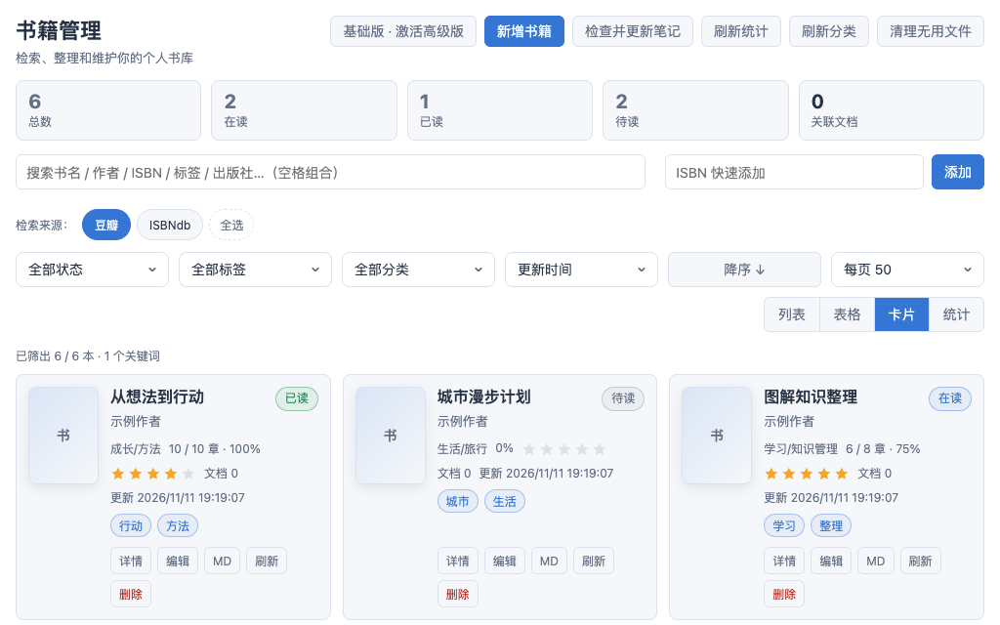

# 书籍管理

在思源笔记中整理藏书、记录阅读进度，让每一本书与读书笔记相连。

无论是维护待读清单，还是整理读过的书，都可以从一个书库开始：添加书籍、设置封面、记录心得，再按自己的习惯分类和查找。

[项目主页](https://github.com/zhangzhishi1/siyuan-plugin-book-manager) · [版本下载](https://github.com/zhangzhishi1/siyuan-plugin-book-manager/releases) · [问题反馈](https://github.com/zhangzhishi1/siyuan-plugin-book-manager/issues) · [购买高级版](https://e.tb.cn/h.j9xZFoT3Oz3FKjg?tk=wTj86dm4H5t)

## 界面预览

*界面使用演示书目展示，实际显示以安装版本为准。*

## 主要功能

### 整理自己的藏书

- 手动添加、编辑和删除书籍，记录书名、作者、出版社、ISBN 等信息。
- 上传或粘贴封面，也可以通过图片链接保存网络封面。
- 为书籍设置分类和标签，把不同主题、用途的书整理到一起。
- 记录个人笔记，留下选书理由、阅读感受和待思考的问题。

### 看见阅读进度

- 用「待读、在读、已读、暂停」区分阅读状态。
- 记录阅读进度与章节，方便下次接着读。
- 为读过的书评分，逐渐积累自己的阅读记录。

### 按习惯浏览与查找

- 支持列表、表格和网格三种视图。
- 按书名、作者、ISBN、标签、出版社或个人笔记搜索。
- 结合阅读状态、分类和标签筛选，快速缩小查找范围。
- 按更新时间、书名、作者、阅读进度或评分等排序。

### 用高级版减少重复整理

- **ISBN 检索**：通过多个来源查找书籍，对比候选结果，补全书名、作者、出版社、出版日期、封面和标签等信息。
- **书籍文件管理**：添加 PDF、EPUB、MOBI、AZW3、TXT 等本地文件，或保存外部链接，集中管理阅读资料。
- **连接思源笔记**：为书籍关联一个思源文档，生成并更新包含书籍信息的卡片，保留卡片之外的手写内容。
- **分类与统计**：根据关联文档所在位置同步分类，查看阅读与关联文档统计，以及分类、标签概览。

> ISBN 检索结果取决于来源收录和网络状况，不保证每本书都能查到。文件管理用于整理已有资料，不代表插件内置各类电子书阅读器。

## 基础版与高级版

| 功能 | 基础版 | 高级版 |
| --- | --- | --- |
| 手动管理书籍与书目信息 | 支持 | 支持 |
| 封面、分类、标签与个人笔记 | 支持 | 支持 |
| 阅读状态、进度、章节与评分 | 支持 | 支持 |
| 多种视图、搜索、筛选与排序 | 支持 | 支持 |
| ISBN 多来源检索与信息补全 | — | 支持 |
| 本地书籍文件与外部链接管理 | — | 支持 |
| 思源文档关联与书籍卡片更新 | — | 支持 |
| 文档树分类同步与统计概览 | — | 支持 |

基础版适合手动维护书库和阅读记录；高级版适合希望减少信息录入、集中整理书籍文件，并将书库与思源笔记联动的用户。

## 开始使用

适用于 **思源笔记 3.7.0 及以上版本的 Windows、macOS、Linux 桌面端**，暂不承诺移动端支持。

1. **安装并启用**：在思源「设置 → 集市 → 插件」中查找「书籍管理」；如未找到，可前往[版本下载页面](https://github.com/zhangzhishi1/siyuan-plugin-book-manager/releases)查看已发布版本及安装包。
2. **添加第一本书**：点击顶部栏的书籍图标打开书库，填写书名等信息，添加封面并设置阅读状态。
3. **建立整理习惯**：为书籍添加分类和标签，阅读时更新进度，随手记下心得。
4. **按需使用高级功能**：激活高级版后，可通过 ISBN 补全信息、添加书籍文件、关联思源文档，再使用「更新笔记」生成或刷新书籍卡片。

## 高级版开通

[前往购买高级版](https://e.tb.cn/h.j9xZFoT3Oz3FKjg?tk=wTj86dm4H5t)。授权期限、设备规则及交付内容以购买页面和实际授权信息为准。

在插件设置中点击「激活」，按购买页面要求提供本机码，取得授权码后粘贴并联网完成激活。

- 首次激活和重新提交授权码需要联网；已经成功激活且仍在有效期内的授权，启动时遇到网络故障可继续离线使用高级功能。
- 授权失效或取消激活后，仍可使用基础版；已有书库、笔记、书籍文件和关联信息不会因此删除，高级功能的新增、修改与同步会暂停。
- 取消本机激活不等于解除设备绑定；换机请按购买页面说明处理。

## 使用提醒

- **更新前先备份**：建议备份整个思源工作空间，保留书库、资源文件与笔记；更新后重新启用插件或重启思源。
- **迁移时保留完整数据**：不要只复制插件程序；如曾使用独立个人版，请先备份并确认数据迁移完整，再停用旧版。
- **按需联网**：ISBN 检索、网络封面下载和授权激活需要访问相应服务；授权请求不会上传书库、个人笔记或电子书文件。
- **保护授权信息**：反馈问题或分享截图时，请遮挡完整授权码和设备绑定信息。
- **不提供电子书下载**：本插件用于管理自行持有的书籍信息和阅读资料，不附带电子书内容。

遇到问题或有功能建议，欢迎通过[问题反馈](https://github.com/zhangzhishi1/siyuan-plugin-book-manager/issues)说明使用场景。
